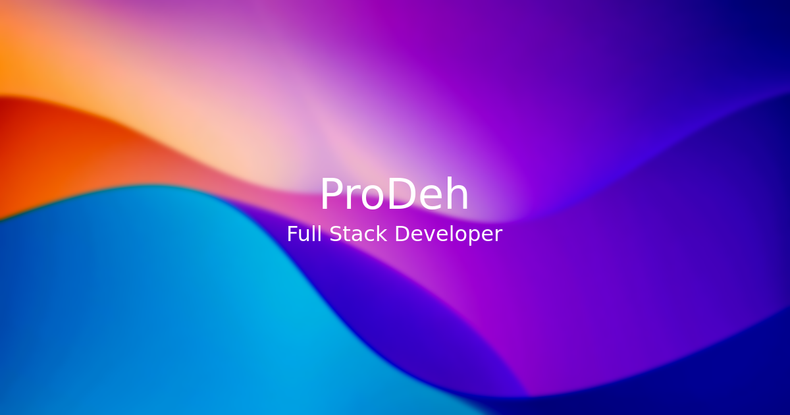

# ProDeh — Portfolio

A desktop operating system that happens to be a portfolio. You get a wallpaper,
desktop icons, a taskbar with a working clock, and draggable windows for the
actual content: About Me, Projects, Skills, Settings and Contact. Every app is
deep-linkable (`/about-me`, `/projects`, ...) so windows can be shared as normal
URLs, and unknown paths get a themed "file not found" dialog.



## Stack

- [SvelteKit 2](https://svelte.dev/docs/kit) + Svelte 5 (runes)
- Tailwind CSS 4 + daisyUI 5 (light / business themes, switchable in the
  Settings app)
- [@neodrag/svelte](https://www.neodrag.dev/) for window dragging
- Deployed on Cloudflare Pages via `@sveltejs/adapter-cloudflare`
- Bun as the package manager

## Developing

```sh
bun install
bun run dev        # dev server
bun run preview    # production build previewed via wrangler pages dev
```

## Building and deploying

```sh
bun run build      # vite build + adapter-cloudflare
bun run check      # wrangler types + svelte-check
bun run lint       # prettier --check + eslint
bun run format     # prettier --write
```

## How it hangs together

- **Window state** lives in `src/lib/store/store.svelte.ts` as Svelte 5 runes:
  `currentApp` (which window is open), `windowState`
  (open/minimized/maximized), theme and wallpaper. `openApp()`/`closeApp()`
  keep that state in sync with the URL.
- **Apps** are plain Svelte components in `src/components/apps/` rendered
  inside a single draggable `Window`. They are mapped from the URL by the
  layout, so adding an app means: a component, an entry in `appsList`
  (name/route/icon), and a mapping entry in `src/routes/+layout.svelte`.
- **Settings** (theme, wallpaper) persist to `localStorage`.
- The Projects app pulls live data from the GitHub API (forks and archived
  repos filtered out, sorted by stars/recency) and degrades to an error card
  with retry when the API objects.
- A themed terminal app and a phone-mode layout are planned (see
  `brain/plans/01-portfolio-overhaul/overview.md`).
